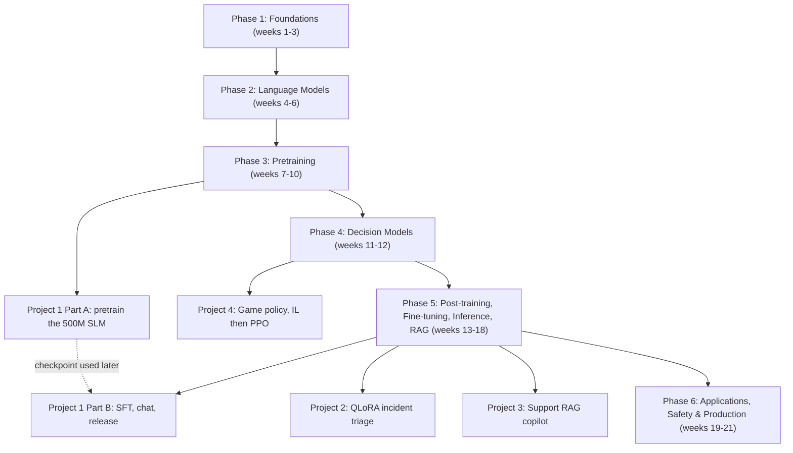

# Learning Roadmap

This is a 21-week, part-time plan that takes you through every core section of the site and all four projects. It assumes about **8-12 hours a week**: two or three weekday evenings of reading and small experiments, plus one longer weekend block for project work. Each week lists the pages to read, what to build, and a short checklist so you know when you are done.

!!! abstract "What you'll learn"
    - The order to read the site in, and why that order matters
    - Which weeks to spend on which pages and projects
    - Concrete milestones, as checklists, that tell you when to move on
    - How to adjust the plan if you have more time, less time, or a narrower goal

## The path at a glance

The plan has six phases. Projects sit at the end of the phase that teaches what they need. The sidebar lists Decision Models after Applying Models; this plan pulls it forward to weeks 11-12 on purpose. Project 4 is a change of pace after the pretraining phase, it reuses Foundations directly, and its policy-gradient ideas come back in the Post-training pages.

Project 1 is split in two. **Part A** (weeks 7-10) covers the tokenizer, the data, pretraining and the base-model evaluation. The full pretraining run is short in wall-clock terms: about 3.5 hours on an 8x H100 node for 10B tokens (about 26 hours on one H100), or about 16 hours on the node for 50B tokens. These are estimates from the project's FLOPs calculation. **Part B** (week 13) turns the checkpoint into a chat model and releases it, once the SFT page has been read.

Two pages are electives and are not scheduled: [Architecture Families & Beyond Transformers](../llm/architecture-families.md) and [Multimodal Models](../llm/multimodal.md). No project depends on them. Read them any time after week 6. The [Cheat Sheet](../cheatsheet.md) collects the formulas and default hyperparameters used in the weekly checklists. If the goal is narrower than the whole site, [Choose Your Path](paths.md) lists shorter routes.

## Phase 1: Foundations (weeks 1-3)

Goal: you can derive and implement backpropagation, and you can write a PyTorch training loop from memory.

### Week 1: Setup and math

- Read [Start Here](index.md) and [Setup, Hardware & Budget](setup.md). Install your environment, create Hugging Face and Weights & Biases accounts. Skip the section on rented GPU nodes until week 10.
- Read [Math You Actually Need](../foundations/math.md). Run every numpy snippet.
- Optional: watch the 3Blue1Brown linear algebra series if vectors and matrices feel shaky (see [Resources](../resources.md)).

- [ ] `python -c "import torch; print(torch.__version__)"` works and reports your accelerator (CUDA or MPS)
- [ ] You can compute softmax and cross-entropy by hand for a 3-class example
- [ ] You can explain why the max is subtracted before `exp` in softmax

### Week 2: PyTorch

- Read [Python & PyTorch](../foundations/pytorch.md).
- Write a training loop for a small classifier on MNIST or a synthetic dataset, without copying.

- [ ] You can explain what `loss.backward()`, `optimizer.step()`, and `optimizer.zero_grad()` each do
- [ ] You can write an `einsum` for batched matrix multiply and for attention scores
- [ ] You have hit and fixed at least one shape bug and one device bug

### Week 3: Neural networks and backprop

- Read [Neural Networks & Backprop](../foundations/neural-networks.md).
- Implement the numpy MLP and the micrograd-style autograd engine from the page. Compare your gradients to PyTorch's.

- [ ] Your hand-written gradients match `torch.autograd` to within about `1e-6`
- [ ] You can write the AdamW update equations from memory
- [ ] You can explain why a learning rate that is too high makes the loss go to `nan`

## Phase 2: Language Models (weeks 4-6)

Goal: you can write a GPT-style decoder from scratch and train a tiny one on a laptop.

### Week 4: Tokenization and attention

- Read [Tokenization](../llm/tokenization.md). Train a small BPE tokenizer.
- Read [Embeddings & Attention](../llm/attention.md). Implement causal self-attention.

- [ ] You can explain why a model cannot "see" individual characters in a token
- [ ] Your attention implementation matches `torch.nn.functional.scaled_dot_product_attention`
- [ ] You can explain what the causal mask prevents

### Week 5: The transformer

- Read [The Transformer, Line by Line](../llm/transformer.md).
- Train a character- or BPE-level model with a few million parameters on a small text corpus. Generate samples.

- [ ] Your tiny model's loss drops well below the uniform baseline of `ln(vocab_size)`
- [ ] Samples look like the training text's style, even if they are nonsense
- [ ] You can count your model's parameters by hand and match `sum(p.numel() for p in model.parameters())`

### Week 6: Modern architectures and scaling

- Read [Modern Architectures & SLM Design](../llm/modern-architectures.md) and [Scaling Laws & Compute](../llm/scaling-laws.md).
- Swap your tiny model to RMSNorm, RoPE, and SwiGLU. Compare loss curves at equal parameter count.

- [ ] You can estimate training FLOPs with the `6 * N * D` rule
- [ ] You can explain roughly how many tokens a compute-optimal 500M model wants
- [ ] You can justify each architectural choice in Project 1's config

## Phase 3: Pretraining and Project 1 Part A (weeks 7-10)

Goal: a pretrained 500M-parameter base model, with a loss curve you understand and a HellaSwag score. The project ships complete code. The work each week is to run it, read it against the concept page, and change it. To write the files yourself instead, see "Two ways to do this project" at the top of the project page.

### Week 7: Data

- Read [Pretraining](../pretraining/index.md) and [Data Pipelines](../pretraining/data.md).
- Start [Project 1](../projects/p1-500m-model.md): run the smoke tests, then do the data half of [Part 0](../projects/p1-500m-model.md#part-0-train-a-30m-model-on-your-laptop) (train an 8k tokenizer and write TinyStories shards).
- Train the 49k tokenizer and start tokenizing FineWeb-Edu on a CPU machine. It takes a few hours and needs no GPU.

- [ ] `train.py --tiny`, `sft.py --tiny` and `convert_to_hf.py --check` pass
- [ ] You have tokenized shards and can decode a random training window from them
- [ ] You know how many tokens your full dataset contains

### Week 8: The training loop

- Read [The Training Loop](../pretraining/training.md) and [Debugging a Training Run](../pretraining/debugging.md).
- Read Project 1's `train.py` against the page: mixed precision, gradient accumulation, warmup and the WSD (warmup-stable-decay) schedule, gradient clipping, checkpointing, logging.
- Train the `p30m` preset (31.5M parameters) on TinyStories on your laptop or a free Colab GPU: the training half of Part 0.

- [ ] The `p30m` run finishes without errors and its samples read like simple stories
- [ ] You can resume from a checkpoint with `--resume` and the loss curve continues smoothly
- [ ] You can explain your effective batch size in tokens

### Week 9: Distributed training and evaluation

- Read [Distributed Training](../pretraining/distributed.md) and [Evaluation](../pretraining/evaluation.md).
- From [GPU Performance Engineering](../pretraining/gpu-performance.md), read only two sections: the [throughput-tuning checklist](../pretraining/gpu-performance.md#a-practical-throughput-tuning-checklist) and [profiling](../pretraining/gpu-performance.md#profiling-with-torchprofiler). The rest of that page (roofline, FlashAttention internals, Triton kernels, FP8) is advanced material to come back to.
- Rent one data-center GPU for an hour. Run 200 steps of the real config, read tokens/second and MFU from the log, and run the validation-loss and HellaSwag scripts on that checkpoint. If you can rent 2 or more GPUs, launch the same config with `torchrun` (DDP).

- [ ] A 200-step run of the real config shows falling loss, and MFU above about 30%
- [ ] If you ran on 2+ GPUs: throughput scales close to linearly
- [ ] You have a budget estimate for the full run (see [Setup](setup.md#budgeting-a-run))

### Week 10: The full run

- Read [Running a long job on a rented GPU node](setup.md#running-a-long-job-on-a-rented-gpu-node).
- Rent the hardware and launch the full pretraining run. The 10B-token run is an afternoon on an 8-GPU node, so stay with it: watch the first 30 minutes closely, then check the log every half hour.
- When it finishes, record the validation loss and HellaSwag for several checkpoints, copy the checkpoints off the node, and shut the node down. That completes Part A.

- [ ] Loss fell smoothly with no spikes you cannot explain
- [ ] Checkpoints are on durable storage (not only the instance's local disk)
- [ ] You set a hard spending cap or a scheduled shutdown before launching
- [ ] Validation loss and HellaSwag are recorded for the final checkpoint

## Phase 4: Decision Models and Project 4 (weeks 11-12)

Goal: a neural network that controls a game character, first by copying demonstrations, then by improving with RL.

### Week 11: RL concepts and imitation

- Read [Decision Models](../decision/index.md), [Reinforcement Learning Basics](../decision/rl-basics.md), and [Imitation Learning](../decision/imitation.md).
- Start [Project 4](../projects/p4-decision-model.md): set up the environment, record demonstrations, train a behavior-cloning policy.

- [ ] You can define state, action, reward, return, and policy in one sentence each
- [ ] Your behavior-cloning policy moves the character sensibly on easy levels
- [ ] You have seen compounding errors happen and can explain them

### Week 12: PPO and fast policies

- Read [DQN & PPO](../decision/policy-methods.md) and [System 1 & System 2 Models](../decision/system-one.md).
- Fine-tune the behavior-cloning policy with PPO. Compare against PPO from scratch. Export the policy to ONNX.

- [ ] PPO from behavior cloning finishes episodes faster than behavior cloning alone, with a success rate within a few points of it (PPO does not raise the success rate here)
- [ ] You can explain the clipped surrogate objective
- [ ] You can explain why initializing from imitation speeds up RL

## Phase 5: Post-training, Fine-tuning, Inference, RAG (weeks 13-18)

Goal: you can take an open-weight model, adapt it to a real job, serve it, and ground it in your own documents.

### Week 13: SFT, preference optimization and Project 1 Part B

- Read [Post-training](../post-training/index.md), [Supervised Fine-Tuning](../post-training/sft.md), and [Preference Optimization](../post-training/preference.md).
- Do [Project 1 Part B](../projects/p1-500m-model.md#part-b-sft-chat-and-release): run SFT on your base checkpoint, chat with the result, convert it to Hugging Face format and publish it. This needs one GPU for a few hours.

- [ ] You can explain why SFT masks the loss on prompt tokens
- [ ] You can write the DPO loss and say what each term does
- [ ] Your chat model answers in ChatML, stops at `<|im_end|>`, and is on the Hub with a model card

### Week 14: Reasoning and LoRA

- Read [Reasoning & RL with Verifiable Rewards](../post-training/reasoning-rl.md), [Distillation & Synthetic Data](../post-training/distillation-synthetic-data.md), [Fine-tuning](../finetuning/index.md), and [LoRA & QLoRA](../finetuning/lora-qlora.md).
- Start [Project 2](../projects/p2-finetune.md): generate and inspect the incident-triage dataset, run the evaluation self-check, then measure the prompted baseline.
- Project 2 relies on two things that are scheduled later. Read the [Structured output](../applications/prompting.md#structured-output) section of Prompt & Context Engineering now (about 10 minutes), and use [Quantization & Serving](../inference/serving.md) as a reference when you serve the model.

- [ ] You have a held-out test set that the model never sees during training
- [ ] You have a baseline score from the un-tuned model (prompted only)
- [ ] You can compute how much GPU memory QLoRA needs for your chosen model

### Week 15: Finish Project 2

- Train the QLoRA adapter. Evaluate, inspect failures, iterate on data rather than hyperparameters first.
- Read [Continued Pretraining & Model Merging](../finetuning/merging-continued-pretraining.md).
- Optional, if you plan to use the model at work: read [Deployment patterns](../production/llmops.md#deployment-patterns) for shadow mode, which Project 2's "At work" milestones use.

- [ ] The adapter beats the prompted baseline on your test set
- [ ] You have read at least 30 model outputs by hand
- [ ] You re-evaluated the model in the format you serve (adapter, merged weights, or GGUF)

### Week 16: Inference

- Read [Inference](../inference/index.md), [Decoding: Sampling, KV Cache & Batching](../inference/inference.md), and [Quantization & Serving](../inference/serving.md).
- Serve your Project 2 model (merged or with adapter) and measure latency and throughput. Try a quantized version.

- [ ] You can explain why decoding is memory-bandwidth bound
- [ ] You can estimate KV cache size for a given context length and batch size
- [ ] You have compared quality before and after quantization on your test set

### Week 17: RAG

- Read [RAG](../rag/index.md), [RAG Fundamentals](../rag/fundamentals.md), and [Advanced RAG & Evaluation](../rag/advanced.md).
- Start [Project 3](../projects/p3-rag.md): ingest product docs and resolved tickets, chunk, embed, index.

- [ ] You have a labeled set of questions with known relevant documents
- [ ] You measure retrieval recall@k before touching the generator

### Week 18: Finish Project 3

- Add hybrid search and reranking, citation of sources, and an "I don't know" path. Evaluate end to end.

- [ ] The copilot cites the source for every answer
- [ ] You have measured faithfulness and answer quality, not just retrieval

## Phase 6: Applications, Safety & Production (weeks 19-21)

Goal: turn your models into applications that are safe and that you can operate.

### Week 19: Prompting and agents

- Read [Applications](../applications/index.md), [Prompt & Context Engineering](../applications/prompting.md), and [Agents & Tool Use](../applications/agents.md).
- Wrap your Project 3 copilot and Project 2 model as tools in the from-scratch agent loop. Expose one of them as an MCP server.

- [ ] Your Project 2 model always returns valid JSON with constrained decoding
- [ ] The agent stops at its step limit and asks a human before irreversible actions

### Week 20: Safety and interpretability

- Read [Safety & Production](../production/index.md), [Safety, Red-Teaming & Guardrails](../production/safety.md), and [Interpretability](../production/interpretability.md).
- Red-team your Project 3 copilot with indirect prompt injection planted in a document. Add guardrails, then measure attack success rate before and after.
- Train a linear probe and run the logit lens on your Project 1 model.

- [ ] You have an attack success rate measured on a fixed attack set
- [ ] You can show one feature your Project 1 model represents linearly

### Week 21: LLMOps and wrap-up

- Read [LLMOps: Shipping & Operating Models](../production/llmops.md) and [Decision Models for Routing & Classification](../decision/routing-models.md). Routing models are scheduled here because their main use is in production systems: deciding which model, tool or team handles a request.
- Put each project's eval suite in CI as a regression gate. Build a cost-per-1K-requests estimate for Projects 2 and 3.
- Work through the production readiness checklist for one project.

- [ ] Evals run automatically on every change, and a regression blocks the merge
- [ ] You can say when a small classifier is a better router than a generative model
- [ ] All four projects have a short README: what you built, results, what you would do next

## Adjusting the plan

=== "More time (20+ h/week)"

    Run two weeks per calendar week through Phases 1-2 and Phases 4-6. Keep Phase 3 at one week per week: tokenizing the corpus and debugging on a small config need calendar time, even though the full run itself takes hours. You can finish in about 11-12 weeks.

=== "Less time (4-6 h/week)"

    Keep the order and double each week. Consider shrinking Project 1 to the `p125m` preset (about 126M parameters, one 24 GB GPU): it teaches the same lessons at a fraction of the cost.

=== "Applied focus"

    If your goal is shipping LLM features at work, do Phase 1, Phase 2 weeks 4-5, then jump to Phase 5 (skip Project 1 Part B). Do Projects 2 and 3, then Phase 6. Come back to Pretraining and Project 1 later. [Choose Your Path](paths.md) has the page-by-page version.

=== "RL focus"

    Do Phase 1, then Phase 4 immediately, with Project 4. Add [Decision Models for Routing & Classification](../decision/routing-models.md), and the [Reasoning & RL](../post-training/reasoning-rl.md) page to see how the same policy-gradient ideas are used to train language models.

!!! warning "Common pitfalls"
    - **Skipping Foundations.** The most common time sink later is a training bug that is really a misunderstanding of gradients, dtypes, or shapes.
    - **Starting the big run too early.** Debug the Project 1 script on a tiny config until it is boring. Every bug found on rented 8-GPU hardware is expensive.
    - **Tuning hyperparameters before fixing data.** In Projects 2 and 3, data quality and evaluation design matter more than learning rate.
    - **No held-out evaluation.** If you cannot measure it, you cannot tell whether a change helped.
    - **Forgetting to shut down instances.** Set billing alerts and auto-shutdown before you launch anything.

## Check your understanding

??? question "Why is Project 1 split, with the pretraining run in week 10 and SFT in week 13?"
    Part A needs only the Language Models and Pretraining pages, so it runs while that material is fresh. The run itself is short (about 3.5 hours on an 8-GPU node for 10B tokens), and the three weeks before it are spent making sure it works the first time. Part B needs the SFT page, which comes in week 13. The base checkpoint from Part A is all that Part B needs.

??? question "Why write the evaluation script before training in Project 2?"
    It forces you to define what "good" means, gives you a baseline from the un-tuned model, and prevents you from unconsciously tuning toward examples you have looked at.

??? question "You are in week 15 and your adapter is worse than the prompted baseline. What do you check first?"
    The data and the formatting: is the chat template correct, is the loss masked to responses only, do train labels match the output schema, is there leakage or mislabeling. Then check that the learning rate is not far too high. Hyperparameter sweeps come last.
