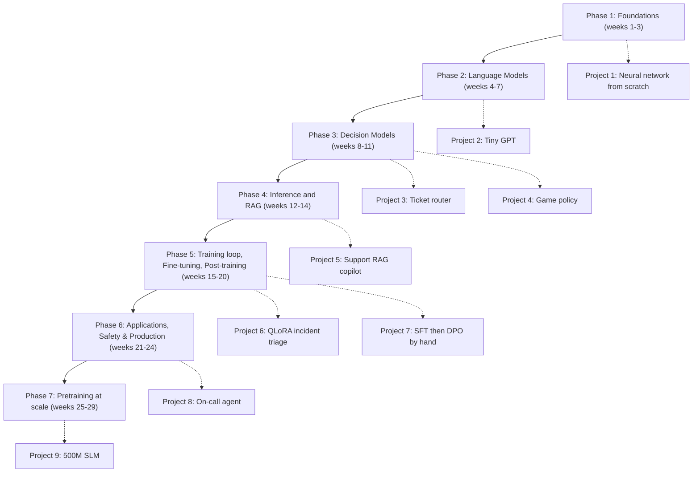

# Learning Roadmap

This is a 29-week, part-time plan that takes you through every core section of the site and all nine projects, in order of difficulty. It assumes about **8-12 hours a week**: two or three weekday evenings of reading and small experiments, plus one longer weekend block for project work. Each week lists the pages to read, what to build, and a short checklist so you know when you are done.

!!! abstract "What you'll learn"
    - The order to read the site in, and why that order matters
    - Which weeks to spend on which pages and projects
    - Concrete milestones, as checklists, that tell you when to move on
    - How to adjust the plan if you have more time, less time, or a narrower goal

## The path at a glance

The plan has seven phases, and each project sits right after the lessons it needs. The phases do not follow the sidebar order (Fundamentals, Training Models, Applying Models, Decision Models): the plan interleaves the tracks so that the projects come in ladder order, from Project 1 to Project 9, and every project's prerequisites are read before it starts.

Three choices in this order are deliberate:

- **Decision Models come early** (weeks 8-11). Projects 3 and 4 are level 2 and run on a laptop, and the policy-gradient ideas from Project 4 come back in the Post-training pages.
- **The Pretraining module is split.** [The Training Loop](../pretraining/training.md) and [Debugging a Training Run](../pretraining/debugging.md) are read in week 15, because Projects 6 and 7 need them. The pages about scale (data pipelines, distributed training, GPU performance, evaluation) are read in weeks 25-27, next to the capstone that uses them.
- **Project 9 is last.** It is the most expensive project, and by week 25 everything it needs has been practiced on smaller models. Its Part 0 warm-up (a 31M model on a laptop, 3-4 hours) is free and can be done any time after week 7.

**Where the 29 weeks come from.** The projects add up to an estimated 114-157 hours of hands-on work, and the pages to a little under 20 hours of reading. Running the code on each page and doing the Build it tasks takes the reading to roughly 40-50 hours. That is 155-205 hours, or 16-20 weeks at 10 hours a week with nothing going wrong. The weekly schedule below comes to 29 weeks (232-348 hours at 8-12 hours a week), which leaves roughly a third of the time as slack for bugs, repeated runs and weeks that are cut short. All of these figures are estimates.

Two pages are electives and are not scheduled: [Architecture Families & Beyond Transformers](../llm/architecture-families.md) and [Multimodal Models](../llm/multimodal.md). No project depends on them. Read them any time after week 7. The [Cheat Sheet](../cheatsheet.md) collects the formulas and default hyperparameters used in the weekly checklists. If the goal is narrower than the whole site, [Choose Your Path](paths.md) lists shorter routes, and the [projects overview](../projects/index.md#the-projects-side-by-side) compares the nine projects.

## Phase 1: Foundations and Project 1 (weeks 1-3)

Goal: you can derive and implement backpropagation, and you can write a PyTorch training loop from memory.

### Week 1: Setup and math

- Read [Start Here](index.md) and [Setup, Hardware & Budget](setup.md). Install your environment, create Hugging Face and Weights & Biases accounts. Skip the section on rented GPU nodes until week 28.
- Read [Foundations](../foundations/index.md) and [Math You Actually Need](../foundations/math.md). Run every numpy snippet.
- Optional: watch the 3Blue1Brown linear algebra series if vectors and matrices feel shaky (see [Resources](../resources.md)).

- [ ] `python -c "import torch; print(torch.__version__)"` works and reports your accelerator (CUDA or MPS)
- [ ] You can compute softmax and cross-entropy by hand for a 3-class example
- [ ] You can explain why the max is subtracted before `exp` in softmax

### Week 2: PyTorch

- Read [Python & PyTorch](../foundations/pytorch.md).
- Write a training loop for a small classifier on MNIST or a synthetic dataset, without copying.

- [ ] You can explain what `loss.backward()`, `optimizer.step()`, and `optimizer.zero_grad()` each do
- [ ] You can write an `einsum` for batched matrix multiply and for attention scores
- [ ] You have hit and fixed at least one shape bug and one device bug

### Week 3: Backprop and Project 1

- Read [Neural Networks & Backprop](../foundations/neural-networks.md).
- Do [Project 1](../projects/nn-from-scratch.md): write the autograd engine, then the numpy MLP that classifies digits. Compare your gradients to PyTorch's.

- [ ] Your hand-written gradients match `torch.autograd` to within about `1e-6`
- [ ] Project 1's tests pass on your code, and you compared it with the reference solution only afterwards
- [ ] You can write the AdamW update equations from memory
- [ ] You can explain why a learning rate that is too high makes the loss go to `nan`

## Phase 2: Language Models and Project 2 (weeks 4-7)

Goal: you can write a GPT-style decoder and its tokenizer from scratch, and train a small one on a laptop.

### Week 4: Tokenization and attention

- Read [Language Models](../llm/index.md) and [Tokenization](../llm/tokenization.md). Train a small BPE tokenizer.
- Read [Embeddings & Attention](../llm/attention.md). Implement causal self-attention.

- [ ] You can explain why a model cannot "see" individual characters in a token
- [ ] Your attention implementation matches `torch.nn.functional.scaled_dot_product_attention`
- [ ] You can explain what the causal mask prevents

### Week 5: The transformer and modern architectures

- Read [The Transformer, Line by Line](../llm/transformer.md) and [Modern Architectures & SLM Design](../llm/modern-architectures.md).
- Do the Build it tasks on both pages.

- [ ] You can draw a decoder block from memory and say what each part is for
- [ ] You can count a small model's parameters by hand and match `sum(p.numel() for p in model.parameters())`
- [ ] You can say what RMSNorm, RoPE, SwiGLU and GQA each replace

### Week 6: Scaling laws, and start Project 2

- Read [Scaling Laws & Compute](../llm/scaling-laws.md).
- Start [Project 2](../projects/tiny-gpt.md): write the BPE tokenizer and the model.

- [ ] You can estimate training FLOPs with the `6 * N * D` rule
- [ ] You can explain roughly how many tokens a compute-optimal 500M model wants
- [ ] Your tokenizer round-trips text: `decode(encode(s)) == s`

### Week 7: Finish Project 2

- Train the Tiny GPT and generate samples. Finish the project's tests.
- With the time left, swap one modern component (RMSNorm, RoPE or SwiGLU) into your model and compare loss curves at equal parameter count.
- Optional, any time from now on: [Part 0 of Project 9](../projects/slm-500m.md#part-0-train-a-30m-model-on-your-laptop), a 31M model trained on a laptop with the capstone's code.

- [ ] Your model's loss drops well below the uniform baseline of `ln(vocab_size)`
- [ ] Samples look like the training text's style, even if they are nonsense
- [ ] Project 2's tests pass on your code

## Phase 3: Decision Models and Projects 3 and 4 (weeks 8-11)

Goal: two kinds of model that choose instead of write. A router that returns probabilities you can act on, and a neural network that controls a game character.

### Week 8: Routing models, and start Project 3

- Read [Decision Models](../decision/index.md) and [Decision Models for Routing & Classification](../decision/routing-models.md).
- Start [Project 3](../projects/ticket-router.md): build the first router and its evaluation.

- [ ] You have a held-out test set and a confusion matrix for your first router
- [ ] You can say when a small classifier is a better router than a generative model
- [ ] You can explain what a reliability diagram shows

### Week 9: Finish Project 3, and RL basics

- Finish Project 3: compare the three model types, calibrate, and set the abstain threshold.
- Read [Reinforcement Learning Basics](../decision/rl-basics.md).

- [ ] Calibration error is measured before and after calibration, on data the calibrator did not see
- [ ] The router abstains on low-confidence tickets, and you chose the threshold from costs, not by eye
- [ ] You can define state, action, reward, return, and policy in one sentence each

### Week 10: Imitation learning, and start Project 4

- Read [Imitation Learning](../decision/imitation.md).
- Start [Project 4](../projects/game-agent.md): set up the environment, record demonstrations, train a behavior-cloning policy.

- [ ] Your behavior-cloning policy moves the character sensibly on easy levels
- [ ] You have seen compounding errors happen and can explain them

### Week 11: PPO and fast policies

- Read [DQN & PPO](../decision/policy-methods.md) and [System 1 & System 2 Models](../decision/system-one.md).
- Fine-tune the behavior-cloning policy with PPO. Compare against PPO from scratch. Export the policy to ONNX.

- [ ] PPO from behavior cloning finishes episodes faster than behavior cloning alone, with a success rate within a few points of it (PPO does not raise the success rate here)
- [ ] You can explain the clipped surrogate objective
- [ ] You can explain why initializing from imitation speeds up RL

## Phase 4: Inference, RAG and Project 5 (weeks 12-14)

Goal: you can run a model behind an endpoint, and ground it in your own documents.

### Week 12: Inference, and start RAG

- Read [Inference](../inference/index.md), [Decoding: Sampling, KV Cache & Batching](../inference/inference.md), and [Quantization & Serving](../inference/serving.md).
- Run a small open-weight model locally behind an OpenAI-compatible endpoint (Ollama is the shortest route) and measure tokens per second. Projects 5 and 8 use this endpoint.
- Read [RAG](../rag/index.md) and [RAG Fundamentals](../rag/fundamentals.md).

- [ ] You can explain why decoding is memory-bandwidth bound
- [ ] You can estimate KV cache size for a given context length and batch size
- [ ] A local endpoint answers a chat request, and you know its tokens per second

### Week 13: Advanced RAG, and start Project 5

- Read [Advanced RAG & Evaluation](../rag/advanced.md).
- Start [Project 5](../projects/support-rag.md): run the smoke test, ingest product docs and resolved tickets, chunk, embed, index. Add hybrid search and reranking.

- [ ] You have a labeled set of questions with known relevant documents
- [ ] You measure retrieval recall@k before touching the generator

### Week 14: Finish Project 5

- Add citation of sources and an "I don't know" path, then the service. Evaluate end to end, and run the red-team script.
- Project 5 uses a few sections of pages scheduled in weeks 22-23; its page links to each one where it is needed.

- [ ] The copilot cites the source for every answer
- [ ] No test question retrieves a document above the caller's access level
- [ ] You have measured faithfulness and answer quality, not just retrieval

## Phase 5: The training loop, Fine-tuning, Post-training and Projects 6 and 7 (weeks 15-20)

Goal: you can take an existing model and change its weights for a real job, once with the standard libraries and once with loops you wrote.

### Week 15: The training loop and debugging

- Read [Pretraining](../pretraining/index.md), [The Training Loop](../pretraining/training.md) and [Debugging a Training Run](../pretraining/debugging.md).
- Apply both pages to your Project 2 training script: add warmup and a decay schedule, gradient clipping, checkpointing with resume, and mixed precision where your device supports it. Run the single-batch overfit test.
- Optional: this is a good week for [Part 0 of Project 9](../projects/slm-500m.md#part-0-train-a-30m-model-on-your-laptop) if it is not done yet.

- [ ] Your Tiny GPT overfits one batch to a loss near 0
- [ ] You can resume from a checkpoint and the loss curve continues smoothly
- [ ] You can explain your effective batch size in tokens

### Week 16: SFT and synthetic data, and start Project 6

- Read [Post-training](../post-training/index.md), [Supervised Fine-Tuning](../post-training/sft.md), and [Distillation & Synthetic Data](../post-training/distillation-synthetic-data.md).
- Start [Project 6](../projects/incident-triage-finetune.md): generate and inspect the incident-triage dataset, run the evaluation self-check, then measure the prompted baseline.
- Project 6 relies on one section that is scheduled later. Read the [Structured output](../applications/prompting.md#structured-output) section of Prompt & Context Engineering now (about 10 minutes).

- [ ] You can explain why SFT masks the loss on prompt tokens
- [ ] You have a held-out test set that the model never sees during training
- [ ] You have a baseline score from the un-tuned model (prompted only)

### Week 17: LoRA and QLoRA

- Read [Fine-tuning](../finetuning/index.md) and [LoRA & QLoRA](../finetuning/lora-qlora.md).
- Train the QLoRA adapter. Evaluate, inspect failures, iterate on data rather than hyperparameters first.

- [ ] You can compute how much GPU memory QLoRA needs for your chosen model
- [ ] The adapter beats the prompted baseline on your test set
- [ ] You have read at least 30 model outputs by hand

### Week 18: Finish Project 6

- Merge and serve the model (merged or with adapter), with [Quantization & Serving](../inference/serving.md) as the reference. Measure latency and throughput, try a quantized version, and add the guardrails.
- Read [Continued Pretraining & Model Merging](../finetuning/merging-continued-pretraining.md).
- Optional, if you plan to use the model at work: read [Deployment patterns](../production/llmops.md#deployment-patterns) for shadow mode, which Project 6's "At work" milestones use.

- [ ] You re-evaluated the model in the format you serve (adapter, merged weights, or GGUF)
- [ ] You have compared quality before and after quantization on your test set
- [ ] The served model returns schema-valid JSON for every test incident

### Week 19: Preference optimization, and start Project 7

- Read [Preference Optimization](../post-training/preference.md).
- Start [Project 7](../projects/post-train-assistant.md): the SFT stage, with the loss mask written by hand.

- [ ] Your SFT loss is computed on response tokens only, and a test proves it
- [ ] You can write the DPO loss and say what each term does
- [ ] The model after SFT answers in the chat format and stops at the end-of-turn token

### Week 20: Finish Project 7

- Read [Reasoning & RL with Verifiable Rewards](../post-training/reasoning-rl.md).
- Finish Project 7: the DPO stage, and the comparison of the model before and after each stage.

- [ ] You measured, on held-out pairs, how often the chosen answer scores above the rejected one, before and after DPO
- [ ] You compared base, SFT and DPO models on the same prompts
- [ ] Project 7's tests pass on your code

## Phase 6: Applications, Safety & Production and Project 8 (weeks 21-24)

Goal: turn the models you built into one application that is safe and that you can operate.

### Week 21: Prompting and agents, and start Project 8

- Read [Applications](../applications/index.md), [Prompt & Context Engineering](../applications/prompting.md), and [Agents & Tool Use](../applications/agents.md).
- Start [Project 8](../projects/oncall-agent.md): the agent loop and its tools, with the Project 3 router, the Project 5 copilot and the Project 6 model behind them.

- [ ] The agent loop runs against a fake model, so its plumbing is tested with nothing else running
- [ ] The agent stops at its step limit and asks a human before irreversible actions

### Week 22: Safety and interpretability

- Read [Safety & Production](../production/index.md), [Safety, Red-Teaming & Guardrails](../production/safety.md), and [Interpretability](../production/interpretability.md).
- Add guardrails to the Project 8 agent. Red-team it with indirect prompt injection planted in a document, and measure attack success rate before and after.
- Train a linear probe and run the logit lens on GPT-2 small, as on the Interpretability page.

- [ ] You have an attack success rate measured on a fixed attack set
- [ ] You can show one feature GPT-2 small represents linearly, with a control probe next to it

### Week 23: LLMOps, MCP and the eval gate

- Read [LLMOps: Shipping & Operating Models](../production/llmops.md).
- Expose the agent's tools as an MCP server. Put the agent's eval suite in CI as a regression gate.

- [ ] An MCP client can list and call your tools
- [ ] Evals run automatically on every change, and a regression blocks the merge

### Week 24: Finish Project 8

- Finish Project 8's milestones. Build a cost-per-1K-requests estimate for the agent, and work through the [production readiness checklist](../production/llmops.md#production-readiness-checklist) for it.

- [ ] The agent passes its evaluation gate
- [ ] Project 8's tests pass on your code
- [ ] You have a cost estimate per 1K requests, with the assumptions written down

## Phase 7: Pretraining at scale and Project 9 (weeks 25-29)

Goal: a pretrained 500M-parameter base model with a loss curve you understand and a HellaSwag score, then a chat model released on the Hub. The project ships complete code. The work each week is to run it, read it against the concept page, and change it. To write the files yourself instead, see "Two ways to do this project" at the top of the project page. Weeks 25-28 are [Part A](../projects/slm-500m.md#part-a-pretrain-and-evaluate-the-base-model) and week 29 is Part B.

The full pretraining run is short in wall-clock terms: about 3.5 hours on an 8x H100 node for 10B tokens (about 26 hours on one H100), or about 16 hours on the node for 50B tokens. These are estimates from the project's FLOPs calculation.

### Week 25: Data

- Read [Data Pipelines](../pretraining/data.md).
- Start [Project 9](../projects/slm-500m.md): run the smoke tests, then do the data half of [Part 0](../projects/slm-500m.md#part-0-train-a-30m-model-on-your-laptop) if it is not done (train an 8k tokenizer and write TinyStories shards).
- Train the 49k tokenizer and start tokenizing FineWeb-Edu on a CPU machine. It takes a few hours and needs no GPU.

- [ ] `train.py --tiny`, `sft.py --tiny` and `convert_to_hf.py --check` pass
- [ ] You have tokenized shards and can decode a random training window from them
- [ ] You know how many tokens your full dataset contains

### Week 26: The training script

- Read Project 9's `train.py` against [The Training Loop](../pretraining/training.md): mixed precision, gradient accumulation, warmup and the WSD (warmup-stable-decay) schedule, gradient clipping, checkpointing, logging.
- Train the `p30m` preset (31.5M parameters) on TinyStories on your laptop or a free Colab GPU: the training half of Part 0. If that is already done, read the project's architecture and compute-budget sections against your Project 2 model.

- [ ] The `p30m` run finishes without errors and its samples read like simple stories
- [ ] You can resume from a checkpoint with `--resume` and the loss curve continues smoothly
- [ ] You can justify each architectural choice in Project 9's config

### Week 27: Distributed training and evaluation

- Read [Distributed Training](../pretraining/distributed.md) and [Evaluation](../pretraining/evaluation.md).
- From [GPU Performance Engineering](../pretraining/gpu-performance.md), read only two sections: the [throughput-tuning checklist](../pretraining/gpu-performance.md#a-practical-throughput-tuning-checklist) and [profiling](../pretraining/gpu-performance.md#profiling-with-torchprofiler). The rest of that page (roofline, FlashAttention internals, Triton kernels, FP8) is advanced material to come back to.
- Rent one data-center GPU for an hour. Run 200 steps of the real config, read tokens/second and MFU from the log, and run the validation-loss and HellaSwag scripts on that checkpoint. If you can rent 2 or more GPUs, launch the same config with `torchrun` (DDP).

- [ ] A 200-step run of the real config shows falling loss, and MFU above about 30%
- [ ] If you ran on 2+ GPUs: throughput scales close to linearly
- [ ] You have a budget estimate for the full run (see [Setup](setup.md#budgeting-a-run))

### Week 28: The full run

- Read [Running a long job on a rented GPU node](setup.md#running-a-long-job-on-a-rented-gpu-node).
- Rent the hardware and launch the full pretraining run. The 10B-token run is an afternoon on an 8-GPU node, so stay with it: watch the first 30 minutes closely, then check the log every half hour.
- When it finishes, record the validation loss and HellaSwag for several checkpoints, copy the checkpoints off the node, and shut the node down. That completes Part A.

- [ ] Loss fell smoothly with no spikes you cannot explain
- [ ] Checkpoints are on durable storage (not only the instance's local disk)
- [ ] You set a hard spending cap or a scheduled shutdown before launching
- [ ] Validation loss and HellaSwag are recorded for the final checkpoint

### Week 29: Part B and wrap-up

- Do [Project 9 Part B](../projects/slm-500m.md#part-b-sft-chat-and-release): run SFT on your base checkpoint, chat with the result, convert it to Hugging Face format and publish it. This needs one GPU for a few hours. The SFT script does with a 500M model what you wrote by hand in Project 7.
- Write a short README for each project.

- [ ] Your chat model answers in ChatML, stops at `<|im_end|>`, and is on the Hub with a model card
- [ ] All nine projects have a short README: what you built, results, what you would do next

## Adjusting the plan

=== "More time (20+ h/week)"

    Run two weeks per calendar week through Phases 1-6. Keep Phase 7 at one week per week: tokenizing the corpus and debugging on a small config need calendar time, even though the full run itself takes hours. You can finish in about 17 weeks.

=== "Less time (4-6 h/week)"

    Keep the order and double each week. Consider shrinking Project 9 to the `p125m` preset (about 126M parameters, one 24 GB GPU): it teaches the same lessons at a fraction of the cost.

=== "Laptop only"

    Projects 1 to 5 and Project 8 need no GPU, and Project 7 runs on a laptop with its small model. Do Project 6 on a free Colab T4 with the 1.5B model. For Project 9, do Part 0 and read the rest of the page; come back to Parts A and B when renting GPUs is an option.

=== "Applied focus"

    If your goal is shipping LLM features at work, do Phases 1 and 2, then Phases 4, 5 and 6, with Projects 5, 6 and 8. Add week 8 and Project 3 if the agent in Project 8 should route with your own model. Skip Phase 7 and come back to it later. [Choose Your Path](paths.md) has the page-by-page version.

=== "RL focus"

    Do Phase 1, then weeks 9-11 with Project 4. Add weeks 4-5 and week 8 for Project 3, which uses a pretrained encoder, and the [Reasoning & RL](../post-training/reasoning-rl.md) page to see how the same policy-gradient ideas are used to train language models.

!!! warning "Common pitfalls"
    - **Skipping Foundations.** The most common time sink later is a training bug that is really a misunderstanding of gradients, dtypes, or shapes.
    - **Reading the reference solution first.** In the projects with starter code, the tests are the feedback. Open the reference after your version passes, or after an honest hour of being stuck.
    - **Starting the big run too early.** Debug the Project 9 script on a tiny config until it is boring. Every bug found on rented 8-GPU hardware is expensive.
    - **Tuning hyperparameters before fixing data.** In Projects 3, 5 and 6, data quality and evaluation design matter more than learning rate.
    - **No held-out evaluation.** If you cannot measure it, you cannot tell whether a change helped.
    - **Forgetting to shut down instances.** Set billing alerts and auto-shutdown before you launch anything.

## Check your understanding

??? question "Why is Project 9 last, when the Pretraining module comes early in the sidebar?"
    It is the most expensive project, and every mistake on rented GPUs costs money. By week 25 the same ideas have been practiced at small scale: a GPT written by hand (Project 2), a training loop hardened and debugged (week 15), and SFT written by hand (Project 7). The pages about scale are read in weeks 25-27, right before they are used. Part 0 of the project is free, so it can be done much earlier.

??? question "Why write the evaluation script before training in Project 6?"
    It forces you to define what "good" means, gives you a baseline from the un-tuned model, and prevents you from unconsciously tuning toward examples you have looked at.

??? question "You are in week 17 and your adapter is worse than the prompted baseline. What do you check first?"
    The data and the formatting: is the chat template correct, is the loss masked to responses only, do train labels match the output schema, is there leakage or mislabeling. Then check that the learning rate is not far too high. Hyperparameter sweeps come last.

??? question "Project 8 is scheduled in weeks 21-24. What has to exist before it starts?"
    The router from Project 3 (weeks 8-9), the RAG service from Project 5 (weeks 13-14) and the fine-tuned model from Project 6 (weeks 16-18), plus an LLM endpoint such as the local one set up in week 12. Project 8 integrates them as tools; it does not rebuild them.
